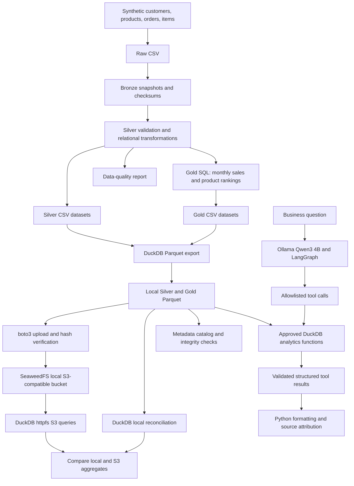

Beauty Commerce Intelligence

Data Engineering | Medallion Architecture | Python | SQL | DuckDB | Apache Parquet | Local S3-Compatible Data Lake | Ollama | Qwen3 | LangGraph

An end-to-end, local-first data engineering and analytical AI portfolio project for a fictional beauty and K-beauty retailer. The solution generates reproducible synthetic commerce data, validates and transforms it through Bronze/Silver/Gold layers, stores analytics-ready Parquet datasets, and exposes approved business metrics to a locally hosted AI agent.
Project status: The local batch pipeline, data-quality checks, Parquet exports, S3-compatible storage integration, metadata catalog, GitHub Actions CI, and a tool-calling AI agent are implemented. The agent has been exercised locally with Ollama and Qwen3 4B. AWS-managed services, MySQL, MongoDB, Airflow, and an interactive dashboard are not implemented. All customer, brand, product, and financial data are synthetic.

1. Business problem and use cases
A fictional cosmetics retailer wants consistent answers to commercial questions without relying on unverified spreadsheet calculations or LLM-generated financial figures:
- What is total completed-order revenue, and how many sales months are represented?
- Which beauty brands generate the highest revenue?
- Which products rank highest by accumulated revenue?
- Can the analytical datasets be reproduced, audited for quality, and reconciled across storage formats?
- Can an AI assistant select approved analytical tools without receiving unrestricted SQL or file-system access?
Reproducible sample results
Metric	Sample result
Customers	80
Products	24
Orders	500
Order items	1,267
Months represented in Gold sales	9
Total completed-order revenue	BRL 281,550.00

These figures are from the project's deterministic synthetic demonstration dataset, not a real business. Re-running the generator with different parameters can change the results.
2. Architecture

Important boundaries: The AI agent reads the local Gold Parquet files through approved Python/DuckDB functions; it does not query SeaweedFS directly. SeaweedFS is a local implementation of S3-compatible object-storage APIs, not a deployment of Amazon S3, AWS Glue, or Athena.
3. Technology stack and implementation status
Component	Technology	Status
Synthetic ingestion and transformations	Python, SQL, SQLite	Implemented
Medallion data model	Raw / Bronze / Silver / Gold	Implemented
Columnar analytics	DuckDB, Apache Parquet	Implemented
Local object storage	Docker Compose, SeaweedFS, boto3	Implemented and tested locally
Data quality and metadata	SQL checks, reconciliation, JSON catalog, unittest	Implemented
CI/CD	GitHub Actions on Ubuntu	Implemented
Local LLM inference	Ollama, Qwen3 4B	Implemented and tested locally
AI tool routing	LangGraph, LangChain ChatOllama, approved Python tools	Implemented and tested locally
Production cloud platform	AWS S3, Glue, Athena, IAM	Not implemented
Additional databases	MySQL, MongoDB	Planned
Orchestration / monitoring	Apache Airflow, freshness checks, SLAs	Planned
Analytical UI	Streamlit or similar	Planned

4. Data products
Dataset	Layer	Purpose
customers, products, orders, order_items	Raw / Bronze / Silver	Generated entities and validated records
monthly_sales	Gold	Completed-order revenue by month, brand, and category
top_products	Gold	Product revenue and monthly rankings
reports/data_quality.json	Quality	Contract results, counts, and related checks
reports/data_catalog.json	Metadata	Local catalog with dataset schemas, keys, upstream sources, and row counts

Monetary source fields use integer BRL cents. The displayed agent responses convert amounts to BRL. Cancelled and refunded orders are excluded from completed-order revenue; shipping is not modeled.

The project generates six local Parquet datasets: four Silver entities plus gold/monthly_sales.parquet and gold/top_products.parquet.
5. AI agent: design and behavior
The Beauty Analytics AI Agent is a tool-calling application, not a free-form text-to-SQL agent. A local Qwen3 4B model interprets the question, and a LangGraph workflow routes it to one of three approved tools:
Approved tool	Data source	Output
get_sales_overview	gold/monthly_sales.parquet	Revenue, months represented
get_top_brands	gold/monthly_sales.parquet	Revenue ranking by brand
get_top_products	gold/top_products.parquet	Accumulated revenue ranking by product

The tools use parameterized, predefined read-only DuckDB queries and a table allowlist. Tool arguments for rankings are constrained to an integer limit from 1 to 10. The graph stops after the tool step, and Python formats the returned values rather than displaying an unverified LLM-written financial answer.
Implemented safeguards
- No general-purpose SQL execution is exposed to the model.
- Only the three explicitly registered analytics tools can be called through the graph.
- The data functions restrict Parquet access to the two expected Gold datasets.
- A lightweight deterministic policy rejects several common forecasting requests before model invocation.
- No commercial result is displayed when the model invokes no approved tool.
- The interface labels all results as synthetic and names the source dataset.
Limitations: Keyword-based forecast detection is incomplete and can miss paraphrases or misclassify requests. Tool-routing behavior is model-dependent. The project is not a production-grade authorization layer, prompt-injection defense, forecast engine, or fully evaluated agent. Additional adversarial tests, schema validation, logging, and failure handling are on the roadmap.
6. Repository guide
beauty-commerce-intelligence/
├── .github/workflows/ci.yml
├── compose.yaml
├── data/                         # Generated datasets; ignored by Git
│   ├── raw/  bronze/  silver/  gold/
│   └── parquet/silver/  parquet/gold/
├── docs/
│   └── adr/0001-local-first.md
├── reports/                      # Generated local reports; ignored by Git
├── scripts/
│   ├── 01_generate_data.py
│   ├── 02_run_pipeline.py
│   ├── 03_export_parquet.py
│   ├── 04_validate_s3.py
│   ├── 05_upload_parquet_s3.py
│   ├── 06_query_s3.py
│   ├── 07_validate_parquet.py
│   ├── 08_build_catalog.py
│   ├── 09_test_ollama_python.py
│   └── 10_beauty_agent.py
├── sql/                          # Data model SQL definitions
├── src/beauty_commerce/
│   ├── generator.py
│   ├── pipeline.py
│   ├── analytics_tools.py
│   └── agent_policy.py
├── tests/
│   ├── test_pipeline.py
│   ├── test_analytics_tools.py
│   └── test_agent_policy.py
├── .gitignore
└── README.md
7. Local setup — Windows PowerShell
Prerequisites: Windows with Python 3.11+ and sufficient free disk space. Docker Desktop is only required for the optional S3-compatible storage section. Ollama is only required to run the AI agent. This project does not require an AWS account or paid inference API.

From the repository root:
py -3 -m venv .venv
.\.venv\Scripts\python.exe -m pip install duckdb==1.5.6 boto3 python-dotenv langgraph langchain-ollama
Generate the data lake locally
.\.venv\Scripts\python.exe .\scripts\01_generate_data.py
.\.venv\Scripts\python.exe .\scripts\02_run_pipeline.py
.\.venv\Scripts\python.exe .\scripts\03_export_parquet.py
.\.venv\Scripts\python.exe .\scripts\07_validate_parquet.py
.\.venv\Scripts\python.exe .\scripts\08_build_catalog.py
The generator uses a reproducible seed by default. Generated data and reports are not tracked in Git; reproduce them locally before running the AI agent.
Run all automated tests
.\.venv\Scripts\python.exe -m unittest discover -s tests -v
The current test suite contains 15 unit tests across pipeline behavior, SQL analytics functions, and lightweight forecast-policy checks. Tests use isolated synthetic fixtures where appropriate and do not require an Ollama model download.
Run the local AI agent
Install Ollama for Windows, ensure its local server is running, then download the model:
ollama pull qwen3:4b
ollama list
The Ollama service must be reachable at http://127.0.0.1:11434. On supported hardware the model may run on a GPU; CPU inference may be slower. The model download uses local disk space.

Try the approved questions:
.\.venv\Scripts\python.exe -u .\scripts\10_beauty_agent.py "Qual foi o faturamento total?"
.\.venv\Scripts\python.exe -u .\scripts\10_beauty_agent.py "Quais sao as 3 marcas com maior faturamento?"
.\.venv\Scripts\python.exe -u .\scripts\10_beauty_agent.py "Quais sao os 3 produtos com maior faturamento acumulado?"
Try an unsupported forecast question:
.\.venv\Scripts\python.exe -u .\scripts\10_beauty_agent.py "Qual sera o faturamento da empresa no proximo ano?"
The last example is handled by the deterministic policy; it does not produce a fabricated revenue forecast. A basic Ollama/Python connectivity check is available in scripts/09_test_ollama_python.py.
8. Optional local S3-compatible storage
Create a .env file in the repository root with local development-only credentials:
S3_ACCESS_KEY_ID=beauty_local
S3_SECRET_ACCESS_KEY=replace_with_a_strong_local_dev_secret
Never commit .env, share credentials in screenshots, or reuse personal passwords. The Docker Compose file binds the demonstration endpoint to 127.0.0.1:8333.
docker compose config --quiet
docker compose up -d
.\.venv\Scripts\python.exe .\scripts\04_validate_s3.py
.\.venv\Scripts\python.exe .\scripts\05_upload_parquet_s3.py
.\.venv\Scripts\python.exe .\scripts\06_query_s3.py
The workflow uploads the six Silver/Gold Parquet objects, verifies hashes and queries an object through DuckDB httpfs, comparing a revenue aggregate with the local data. To stop containers without deleting the persistent volume:
docker compose down
The s3://beauty-commerce/... keys refer to the private local SeaweedFS bucket, not public Amazon S3 resources.
9. Data quality, metadata and CI
Implemented checks include required fields, valid values, identifiers, referential relationships, Bronze SHA-256 snapshots, Parquet row counts, Gold revenue reconciliation, and a local JSON dataset catalog with upstream lineage hints.

The [CI workflow](.github/workflows/ci.yml) runs on pushes and pull requests using Python 3.11 on Ubuntu. It executes:
1. The Python unittest suite (pipeline, analytics, agent-policy tests).
2. Synthetic CSV generation and the transformation pipeline.
3. Silver/Gold export to Parquet.
4. Parquet schema and revenue reconciliation checks.
5. Parquet integrity checks and metadata catalog validation.
CI does not currently run the Ollama/Qwen3 model or the Docker/SeaweedFS integration. Manual model-routing checks are not equivalent to automated end-to-end agent evaluations. See the workflow history for execution results.
10. Architectural decisions and trade-offs
- Local-first design: No mandatory cloud account or paid API; a free-to-run learning environment with ordinary computer/electricity/internet costs.
- Medallion layers: Separate raw inputs, validation, and consumer-ready Gold outputs.
- Parquet + DuckDB: Efficient columnar analytics on a laptop without a managed cloud warehouse.
- S3-compatible storage: Practice object-storage APIs without claiming AWS-managed infrastructure expertise.
- Tool calling instead of unrestricted SQL: Narrower surface area for errors and unauthorized data access, at the cost of limited question coverage.
- Deterministic formatting: Commercial figures come directly from query results, not unconstrained model prose.
- Tests without local LLM dependency: Fast CI checks cover deterministic components; model-level evaluation remains a separate workstream.
See [ADR-0001: Local-first](docs/adr/0001-local-first.md) for the initial architectural rationale.
11. Roadmap
- [x] Synthetic ingestion and Bronze/Silver/Gold processing.
- [x] DuckDB/Parquet datasets and SQL revenue models.
- [x] S3-compatible object storage locally with SeaweedFS.
- [x] Data quality, metadata catalog, and GitHub Actions validation.
- [x] Local Qwen3 4B tool-calling agent with three approved SQL-backed analytics tools.
- [x] Initial forecasting refusal rules and unit tests.
- [ ] Broader agent evaluation: tool-routing benchmarks, unsupported intents, prompt-injection cases, and error-path coverage.
- [ ] Robust policy, structured validation, and improved audit logs.
- [ ] MySQL and MongoDB connectors, incremental ingestion, and idempotent loads.
- [ ] Apache Airflow orchestration, monitoring, freshness checks, and defined SLAs.
- [ ] Streamlit dashboard and reproducible visual demonstration.
- [ ] Optional AWS deployment design after a dedicated cost/security assessment.
12. Portfolio scope
This is an educational and technical portfolio prototype, not a production deployment or an actual cosmetics company's financial system. It demonstrates data modeling, architectural trade-offs, automated validation, local object-storage integration, and constrained AI tool calling with synthetic data. Future integrations are described as planned, not delivered.