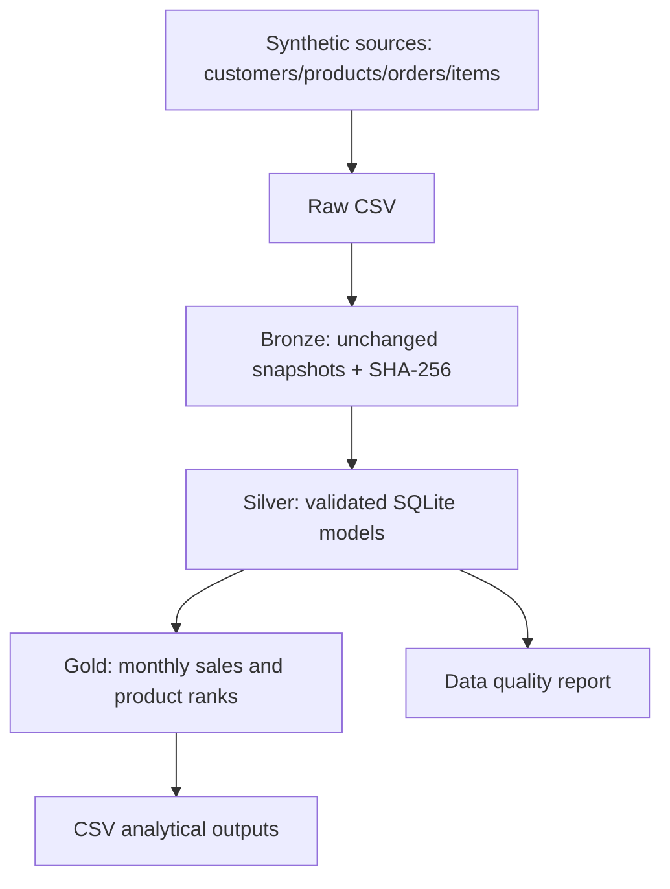

# Beauty Commerce Intelligence

**Data Engineering | AWS (planned) | AI Agents (planned)**

An evolving portfolio project based on a **fictional beauty retailer**, designed to demonstrate reproducible data pipelines, analytical SQL, data quality, architectural decisions, and later AWS integration and AI agent tooling.

> **Project status: Phase 1 (local MVP).** AWS, Airflow, MySQL, MongoDB, Parquet, and AI agents are **not implemented yet**. Data and brands are entirely synthetic; no results describe real businesses.

## Business questions
- Which categories and brands generate the most revenue?
- How does revenue evolve month by month?
- Which products rank highest by monthly revenue?
- Can the analytical outputs be trusted (schema, keys, consistency)?

## Phase 1 architecture



## Quick start (Python 3.11+; zero third-party dependencies)

```bash
python scripts/01_generate_data.py
python scripts/02_run_pipeline.py
python -m unittest discover -s tests -v
```

Windows users may run `py -3` instead of `python`. See [Portuguese start guide](docs/comece-aqui.md).

### Outputs

| File | Purpose |
|---|---|
| `data/raw/*.csv` | Synthetic transactional and catalog records |
| `data/bronze/*.csv` | Original snapshots for lineage |
| `data/silver/*.csv` | Normalized, validated tables |
| `data/gold/monthly_sales.csv` | Revenue grouped by month/category/brand |
| `data/gold/top_products.csv` | Product ranking using SQL window functions |
| `reports/data_quality.json` | Quality status, checksums and record counts |

Monetary amounts are expressed in **BRL cents**. Revenue includes only completed orders; refunds and cancelled orders are excluded.

## Engineering decisions
- Deterministic synthetic data generation (`seed=42`).
- Explicit data contracts, uniqueness and foreign-key checks, and fail-fast validation.
- SHA-256 source snapshots for simple lineage evidence.
- SQL CTEs, aggregation and `DENSE_RANK()` window functions.
- Automated unit tests + GitHub Actions workflow.
- [ADR-0001 — local first](docs/adr/0001-local-first.md).

## Roadmap
1. **Phase 1 — Done:** working local pipeline with tests and documentation.
2. **Phase 2 — Planned:** MySQL/MongoDB via Docker; incremental ingestion and idempotence.
3. **Phase 3 — Planned:** Parquet data lake, Apache Airflow, lineage and freshness tests.
4. **Phase 4 — Planned:** S3, Glue Data Catalog, Athena, access controls and cost monitoring.
5. **Phase 5 — Planned:** analytical AI agent with constrained tools, evaluations and a demo UI.

This is an educational project and does not imply professional production experience with services still on the roadmap.
