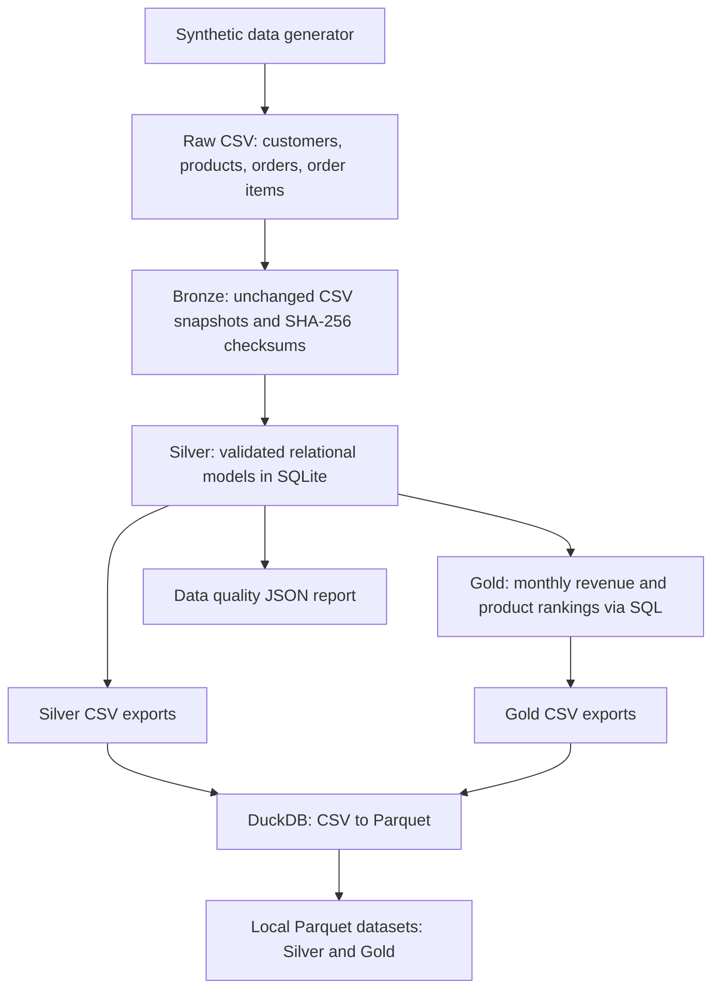

# Beauty Commerce Intelligence

**Data Engineering | Python | SQL | DuckDB | Apache Parquet | AWS (planned) | AI Agents (planned)**

An evolving, end-to-end data engineering portfolio project for a **fictional beauty and K-beauty retailer**. The goal is to transform synthetic commerce data into trustworthy analytical datasets, document architecture decisions, and progressively extend the platform to AWS and AI-powered analytics.

> **Current status: Phase 2 — local pipeline and Parquet export implemented.** AWS, Apache Airflow, MySQL, MongoDB, and AI agents are **planned, not implemented**. All brands, customers, transactions, and financial results in this project are **synthetic**.

## 1. Business context

A beauty retailer needs a consistent view of customers, products, orders, and sales performance. This project builds a reproducible analytical pipeline to answer questions such as:

- Which brands and beauty categories generate the highest revenue?
- How does revenue change from month to month?
- Which products lead monthly sales rankings?
- How can data contracts and validation rules prevent unreliable analytical outputs?

## 2. Implemented architecture



**Important:** This is a local, single-machine implementation. The planned AWS services are not part of the architecture above yet.

## 3. Technology stack

| Technology | Current purpose | Status |
|---|---|---|
| Python 3.11+ | Synthetic data generation and ETL logic | Implemented |
| SQL + SQLite | Relational validation, transformations, and analytics | Implemented |
| DuckDB | Read CSV and export compressed Parquet files | Implemented |
| Apache Parquet | Columnar files for Silver and Gold datasets | Implemented |
| `unittest` | Automated tests of core pipeline behavior | Implemented |
| GitHub Actions | Run pipeline tests and an end-to-end CSV smoke test on Linux | Implemented |
| Amazon S3, Glue Data Catalog, Athena | Cloud data lake, metadata catalog, and SQL queries | Planned |
| MySQL, MongoDB, Apache Airflow | Multiple sources and pipeline orchestration | Planned |
| LangGraph and an LLM | Governed analytical AI agent | Planned |

## 4. Repository structure

```text
beauty-commerce-intelligence/
├── .github/workflows/ci.yml
├── data/
│   ├── raw/                 # Generated source CSVs (ignored by Git)
│   ├── bronze/              # Original source snapshots (ignored by Git)
│   ├── silver/              # Validated CSV datasets (ignored by Git)
│   ├── gold/                # Analytical CSV datasets (ignored by Git)
│   └── parquet/             # Generated Parquet files (ignored by Git)
│       ├── silver/
│       └── gold/
├── docs/
│   ├── adr/0001-local-first.md
│   └── comece-aqui.md
├── reports/                  # Generated quality reports (ignored by Git)
├── scripts/
│   ├── 01_generate_data.py
│   ├── 02_run_pipeline.py
│   └── 03_export_parquet.py
├── sql/
│   ├── schema.sql
│   ├── gold_monthly_sales.sql
│   └── gold_top_products.sql
├── src/beauty_commerce/
│   ├── generator.py
│   └── pipeline.py
├── tests/test_pipeline.py
├── .gitignore
└── README.md
```

## 5. Quick start

### Requirements

- Python 3.11 or newer
- Git (optional for local execution)
- No AWS account or paid API is needed to run the current project

### Windows PowerShell

Run these commands from the repository root:

```powershell
py -3 -m venv .venv
.\.venv\Scripts\python.exe -m pip install duckdb
.\.venv\Scripts\python.exe .\scripts\01_generate_data.py
.\.venv\Scripts\python.exe .\scripts\02_run_pipeline.py
.\.venv\Scripts\python.exe .\scripts\03_export_parquet.py
.\.venv\Scripts\python.exe -m unittest discover -s tests -v
```

### Linux / macOS

```bash
python3 -m venv .venv
.venv/bin/python -m pip install duckdb
.venv/bin/python scripts/01_generate_data.py
.venv/bin/python scripts/02_run_pipeline.py
.venv/bin/python scripts/03_export_parquet.py
.venv/bin/python -m unittest discover -s tests -v
```

The scripts must be run in this order, because each phase consumes outputs from the previous phase. The local pipeline uses Python's standard library; **DuckDB is the only extra dependency for Parquet export**.

For additional setup details in Portuguese, see [the getting-started guide](docs/comece-aqui.md).

## 6. Generated datasets

| Layer | Output | Description |
|---|---|---|
| Raw | `data/raw/*.csv` | Synthetic customers, products, orders, and order items |
| Bronze | `data/bronze/*.csv` | Unmodified snapshots of source files |
| Silver | `data/silver/*.csv` | Validated relational records |
| Gold | `data/gold/monthly_sales.csv` | Revenue by month, category, and brand |
| Gold | `data/gold/top_products.csv` | Monthly product revenue rankings |
| Silver Parquet | `data/parquet/silver/*.parquet` | Four compressed columnar datasets |
| Gold Parquet | `data/parquet/gold/*.parquet` | Two compressed columnar datasets |
| Quality | `reports/data_quality.json` | Validation status, row counts, and source checksums |

With the default deterministic generator (`seed=42`), the sample includes **80 customers, 24 products, 500 orders, and 1,267 order items**. These numbers are demonstration data, not real-world sales.

Monetary values are stored as **integer BRL cents** in the pipeline. Revenue calculations include only `completed` orders; cancelled and refunded orders are excluded. Shipping is not modeled.

## 7. Data quality and engineering decisions

Current safeguards include:

- Required-column checks for input CSV files.
- Non-empty input checks, unique identifiers, and referential consistency checks.
- Business-rule validation for order status, prices, quantities, and dates.
- Fail-fast behavior if an input contract is violated.
- SHA-256 checksums for Bronze snapshots.
- Row-count comparison between each exported CSV and its Parquet counterpart.
- SQL CTEs, aggregations, and `DENSE_RANK()` for analytical transformations.

**Scope of validation:** matching row counts does not prove that column types or every value are identical after CSV-to-Parquet conversion. Automated Parquet schema/value checks, freshness SLAs, and richer lineage are planned enhancements.

Architecture rationale: [ADR-0001 — Local-first implementation](docs/adr/0001-local-first.md).

## 8. Testing and CI

The repository includes three automated `unittest` cases covering:

1. Expected outputs and aggregate revenue.
2. Reproducibility of the synthetic data generator.
3. Rejection of invalid product references.

Run the test suite:

```bash
python -m unittest discover -s tests -v
```

The [GitHub Actions workflow](.github/workflows/ci.yml) runs these tests and a CSV pipeline smoke test on Ubuntu for pushes and pull requests. **Parquet export is currently validated locally; it is not yet included in the CI workflow.**

## 9. Roadmap

- [x] **Phase 1 — Local data engineering MVP:** synthetic datasets, Bronze/Silver/Gold processing, SQL models, data quality rules, and automated tests.
- [x] **Phase 2 — Local columnar lake outputs:** DuckDB export to Apache Parquet, with row-count checks.
- [ ] **Phase 3 — AWS data lake:** S3 storage, Glue Data Catalog, Athena queries, IAM least-privilege permissions, and cost controls.
- [ ] **Phase 4 — Analytical AI agent:** constrained read-only tools over approved analytical datasets, response grounding, evaluation cases, and a simple demo UI.
- [ ] **Phase 5 — Production-oriented extensions:** MySQL and MongoDB integration, incremental ingestion, Apache Airflow orchestration, freshness checks, monitoring, and stronger CI coverage.

Roadmap order may evolve as architectural trade-offs are validated.

## 10. Portfolio intent

This repository is designed to make engineering choices visible: reproducibility, SQL modeling, validation, platform portability, and progressively more realistic architecture. It is a **learning and portfolio project**, not a deployed production platform. Technologies marked **planned** should not be interpreted as implemented experience in this repository.
