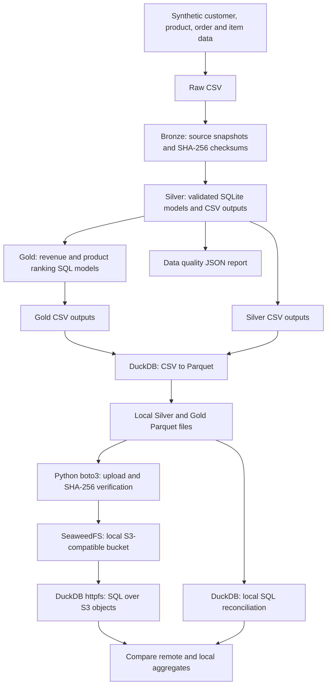

# Beauty Commerce Intelligence

**Data Engineering | Python | SQL | DuckDB | Apache Parquet | S3-Compatible Object Storage | AI Agents (planned)**

An evolving, end-to-end data engineering portfolio project for a **fictional beauty and K-beauty retailer**. The project transforms synthetic commerce data into validated analytical datasets, stores columnar outputs in a local S3-compatible object store, and queries those datasets with SQL.

> **Current status: local data lake with S3-compatible storage.** The Python/SQL pipeline, automated tests, Parquet export, local SeaweedFS bucket, S3 uploads, and remote SQL reconciliation have been implemented and exercised locally. **No AWS account or AWS-managed services are used.** MySQL, MongoDB, Airflow, the analytical AI agent, and the dashboard are planned. All brands, customers, orders, and financial results are synthetic.

## 1. Business problem

A beauty retailer needs trustworthy information about its customers, product catalog, orders, and sales performance. This project addresses questions such as:

- Which brands and product categories generate the most revenue?
- How does revenue change month by month?
- Which products lead the monthly rankings?
- Can analytical outputs be reproduced, validated, and reconciled across storage layers?

## 2. Implemented architecture



**Deployment scope:** SeaweedFS runs locally through Docker Compose. S3-compatible API operations are **not** equivalent to deploying Amazon S3, AWS Glue, or Amazon Athena.

## 3. Technology stack

| Technology | Purpose | Status |
|---|---|---|
| Python 3.11+ | Reproducible synthetic data generation and ETL | Implemented |
| SQL + SQLite | Relational validation and analytical transformations | Implemented |
| DuckDB | Parquet export and SQL queries over local and S3-compatible storage | Implemented |
| Apache Parquet | Columnar Silver and Gold datasets | Implemented |
| Docker Compose + SeaweedFS | Local S3-compatible object storage | Implemented |
| boto3 + python-dotenv | S3 API operations using local environment credentials | Implemented |
| `unittest` | Core pipeline tests | Implemented |
| GitHub Actions | Linux tests and CSV pipeline smoke test | Implemented |
| AWS S3, Glue, Athena | Possible future deployment on actual AWS | Not implemented |
| MySQL, MongoDB, Apache Airflow | Multiple sources, incremental processing, and orchestration | Planned |
| Ollama + LangGraph | Local analytical AI agent | Planned |
| Streamlit | Interactive analytical dashboard | Planned |

## 4. Repository structure

```text
beauty-commerce-intelligence/
├── .github/workflows/ci.yml
├── data/
│   ├── raw/                   # Generated CSVs (ignored)
│   ├── bronze/                # Generated CSV snapshots (ignored)
│   ├── silver/                # Generated validated CSVs (ignored)
│   ├── gold/                  # Generated analytical CSVs (ignored)
│   └── parquet/               # Generated Silver/Gold Parquet (ignored)
├── docs/
│   ├── adr/0001-local-first.md
│   └── comece-aqui.md
├── reports/                   # Generated data quality report (ignored)
├── scripts/
│   ├── 01_generate_data.py
│   ├── 02_run_pipeline.py
│   ├── 03_export_parquet.py
│   ├── 04_validate_s3.py
│   ├── 05_upload_parquet_s3.py
│   └── 06_query_s3.py
├── sql/
│   ├── schema.sql
│   ├── gold_monthly_sales.sql
│   └── gold_top_products.sql
├── src/beauty_commerce/
│   ├── generator.py
│   └── pipeline.py
├── tests/test_pipeline.py
├── compose.yaml
├── .gitignore
└── README.md
```

The `.env` file is created locally and **must not be committed**. Generated datasets and Docker volumes are not stored in Git.

## 5. Run the project locally

### Requirements

- Python 3.11 or newer
- Docker Desktop with a running Docker Engine and Docker Compose
- Internet access for package/image downloads and (if needed) the DuckDB `httpfs` extension
- **No AWS account, paid cloud API, or credit card required**

### Step A — Create the Python environment (Windows PowerShell)

Run from the repository root:

```powershell
py -3 -m venv .venv
.\.venv\Scripts\python.exe -m pip install duckdb boto3 python-dotenv
```

### Step B — Generate, transform, and export data

```powershell
.\.venv\Scripts\python.exe .\scripts\01_generate_data.py
.\.venv\Scripts\python.exe .\scripts\02_run_pipeline.py
.\.venv\Scripts\python.exe .\scripts\03_export_parquet.py
.\.venv\Scripts\python.exe -m unittest discover -s tests -v
```

The generator is deterministic by default (`seed=42`). The current demonstration dataset includes 80 customers, 24 products, 500 orders, and 1,267 order items. These are **synthetic** data.

### Step C — Configure the local S3-compatible service

Create a local `.env` in the repository root using your own development-only values:

```dotenv
S3_ACCESS_KEY_ID=beauty_local
S3_SECRET_ACCESS_KEY=replace_with_your_own_local_secret
```

Do not use personal passwords. Do not commit `.env` or paste its values in issues or screenshots.

Start the service:

```powershell
docker compose config --quiet
docker compose up -d
docker compose ps
```

The local endpoint is `http://127.0.0.1:8333` and the demonstration bucket is `beauty-commerce`. The service should be bound to the loopback interface (`127.0.0.1`) rather than exposed publicly.

### Step D — Validate, upload, and query objects

```powershell
.\.venv\Scripts\python.exe .\scripts\04_validate_s3.py
.\.venv\Scripts\python.exe .\scripts\05_upload_parquet_s3.py
.\.venv\Scripts\python.exe .\scripts\06_query_s3.py
```

The upload script writes six Parquet objects to the bucket (`silver/` and `gold/`) and compares SHA-256 hashes after downloading each object. The query script reads a Gold Parquet object over the S3-compatible API using DuckDB `httpfs`, then compares its aggregate results to the local Parquet counterpart.

Stop the local service without removing its persistent volume:

```powershell
docker compose down
```

## 6. Data products

| Dataset | Layer | Purpose |
|---|---|---|
| `customers`, `products`, `orders`, `order_items` | Raw / Bronze / Silver | Source entities and validated relational data |
| `monthly_sales` | Gold | Revenue by month, category, and brand |
| `top_products` | Gold | Monthly product revenue rankings |
| `reports/data_quality.json` | Quality | Contract status, row counts, and Bronze checksums |

Silver and Gold Parquet files are uploaded with these object keys:

```text
s3://beauty-commerce/silver/customers.parquet
s3://beauty-commerce/silver/products.parquet
s3://beauty-commerce/silver/orders.parquet
s3://beauty-commerce/silver/order_items.parquet
s3://beauty-commerce/gold/monthly_sales.parquet
s3://beauty-commerce/gold/top_products.parquet
```

These are **private local object keys**, not publicly accessible AWS URLs.

All monetary values are recorded as **integer BRL cents**. Revenue includes only completed orders; cancelled and refunded orders are excluded. Shipping is not modeled.

## 7. Data quality, verification, and limitations

Current safeguards:

- Required-column and nonempty-source checks.
- Unique identifiers and referential consistency checks.
- Valid order statuses, dates, quantities, and nonnegative prices.
- Fail-fast validation when a data contract fails.
- SHA-256 checksums for Bronze copies.
- Row-count reconciliation between CSV and Parquet exports.
- SHA-256 reconciliation between uploaded and downloaded Parquet objects.
- Aggregate reconciliation between local and remote DuckDB SQL queries.

**Limitations:** row counts and aggregate reconciliation do not independently prove that all rows and all column types match. The current solution is batch-based, uses small synthetic datasets, and does not yet include incremental ingestion, automated S3 integration tests, a production-grade metadata catalog, or freshness SLAs.

For a documented architecture choice, see [ADR-0001 — Local-first implementation](docs/adr/0001-local-first.md).

## 8. Testing and CI

The current `unittest` suite covers:

1. Expected output files and aggregate revenue.
2. Deterministic synthetic data generation.
3. Rejection of invalid product references.

```powershell
.\.venv\Scripts\python.exe -m unittest discover -s tests -v
```

The [GitHub Actions workflow](.github/workflows/ci.yml) runs these tests and a CSV end-to-end smoke test on Ubuntu. **The Parquet export and S3-compatible integrations have been validated locally but are not yet exercised automatically in GitHub Actions.**

## 9. Zero-cloud-cost approach

The current implementation runs on a local computer using free/open-source software and does not require AWS credentials or a paid inference API. It still uses local CPU, RAM, storage, electricity, and internet connectivity. The repository intentionally does not claim experience running AWS-managed services.

Future cloud deployment would require a separate cost and security assessment.

## 10. Roadmap

- [x] **Phase 1 — Local data engineering:** synthetic data, Bronze/Silver/Gold, SQL transformations, data quality checks, and tests.
- [x] **Phase 2 — Local columnar storage:** DuckDB CSV-to-Parquet export and row-count checks.
- [x] **Phase 3 — S3-compatible lake (local):** SeaweedFS in Docker, boto3 upload, SHA-256 comparison, and remote DuckDB SQL reconciliation.
- [ ] **Phase 4 — Governance and quality automation:** schema/value checks, local metadata catalog, improved tests, and GitHub Actions coverage.
- [ ] **Phase 5 — Analytical AI agent:** local Ollama model, LangGraph tools restricted to approved analytics, evaluations, and traceable answers.
- [ ] **Phase 6 — Additional data sources:** MySQL and MongoDB integration, incremental loads, and idempotence.
- [ ] **Phase 7 — Orchestration and observability:** Airflow DAGs, monitoring, retries, and freshness checks.
- [ ] **Phase 8 — Demo and portfolio presentation:** Streamlit dashboard, architecture documentation, and a demonstration.

## 11. Portfolio intent

This repository documents the progressive design of a reproducible data platform and its technical trade-offs. It is an educational portfolio project, not a deployed production service. Technologies marked **planned** or **not implemented** are not presented as delivered components.
