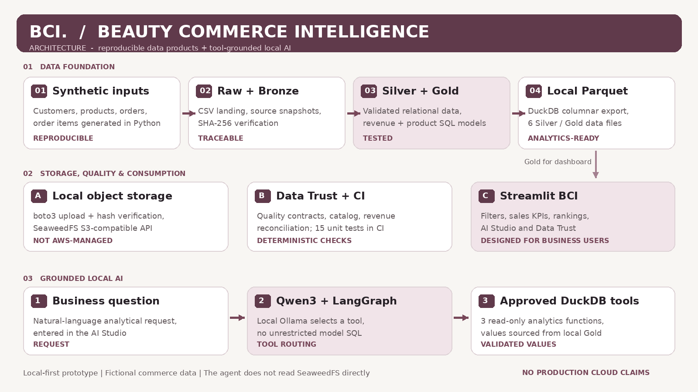

# Architecture overview | Beauty Commerce Intelligence

[Editable Mermaid diagram source](assets/architecture-overview.mmd) · [Main technical case](CASE_STUDY.md)

## Reading the diagram

**01 — Data foundation:** deterministic synthetic customers, products, orders and order items feed raw CSV, SHA-256 Bronze snapshots, validated Silver tables and SQL-transformed Gold models. Monetary source values use integer BRL cents; completed orders drive revenue.

**02 — Analytical storage:** DuckDB exports Silver/Gold to Parquet. Six objects can be copied to a **local SeaweedFS** S3-compatible bucket through boto3, checked by hashes, queried via DuckDB HTTPFS and compared with local aggregates.

**03 — Trust:** data-quality contracts, row counts, referential checks, Gold revenue reconciliation and a JSON metadata catalog capture structural guarantees. GitHub Actions runs the deterministic pipeline/test checks on push and pull request.

**04 — Consumption:** Streamlit reads **local Gold Parquet** for filters, metrics and rankings. AI Studio invokes a local Qwen3 4B model through LangGraph to select one of three approved analytics functions (`get_sales_overview`, `get_top_brands`, `get_top_products`) backed by read-only DuckDB SQL. Python validates and formats tool results.

## Important boundaries

- SeaweedFS exercises S3-compatible APIs **locally** and is not Amazon S3, Glue or Athena. The AI agent does **not** query SeaweedFS directly.
- The **dashboard filters** affect commercial tabs; the **AI Studio** reads the full Gold dataset regardless of those filters, with disclosure in the interface.
- GitHub Actions does **not** currently run interactive Streamlit, the Ollama model or Docker/SeaweedFS tests.
- This diagram is a *logical architecture*, not a claim of production-scale cloud deployment.
